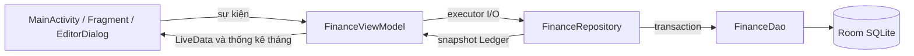

# Kiến trúc Android

- **data/local** chứa bảy entity và DAO dùng Room compiler qua Java annotation processing. Database dùng một instance trong tiến trình và xuất schema v2 khi build.
- **data/repository** chứa các thao tác CRUD Kotlin, quy tắc nguồn tiền, quan hệ ngày, hạn mức và kiểm tra vốn khả dụng. Đọc nhiều bảng và ghi có kiểm tra đều dùng transaction Room.
- **ui** dùng ViewModel chung giữa năm tab. Mỗi form chuyển ID ổn định của danh mục, đợt hoặc khoản vay cho repository. Kết quả ghi có mã thao tác riêng để form khôi phục qua xoay màn hình. ViewModel tổng hợp tháng bằng số nguyên, Canvas chỉ nhận tỷ lệ để vẽ cung tròn.
- **Giải trình** lấy tồn đầu, giải ngân, chi, tồn cuối và danh sách chi theo khoản vay/tháng. Truy vấn lọc nguồn LOAN và danh mục chi, liên kết đợt với khoản vay, đọc chứng từ riêng trong cùng transaction. Hai bộ ghi dùng chung bản xem trước. App tạo tệp tạm trong cache rồi sao chép tới URI do CreateDocument trả về; chỉ thông báo thành công sau khi đóng luồng ghi.

Xem [ERD](erd.md) và [luồng giao diện](ui-integration.md).
