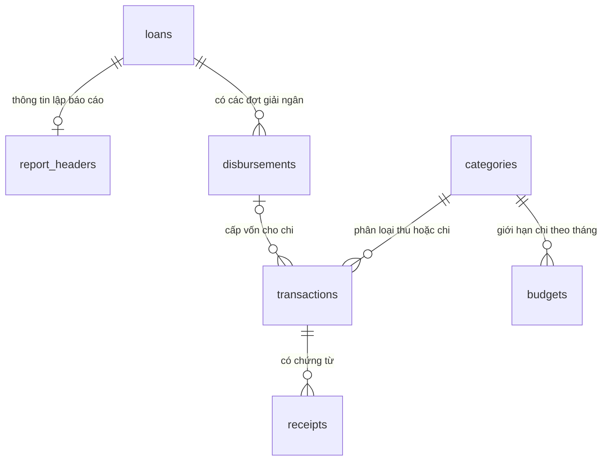

# Room SQLite v2

| Bảng | Khóa và dữ liệu nghiệp vụ |
|---|---|
| loans | id, name, limitVnd (hạn mức được cấp) |
| report_headers | loanId là khóa chính và khóa ngoại đến loans, author, lender. Xóa khoản vay đồng thời xóa thông tin này. |
| disbursements | id, loanId → loans, name, day, amount (tiền thực nhận) |
| categories | id ổn định, name, income. Duy nhất theo (income, name). |
| transactions | id, categoryId → categories, source, disbursementId → disbursements (tùy nguồn), day, amount, note |
| budgets | id, month, categoryId → categories, limitVnd. Duy nhất theo (month, categoryId). |
| receipts | id, transactionId → transactions, uri, displayName, mimeType. Xóa giao dịch sẽ xóa metadata liên quan. |

Khóa chính dùng TEXT phù hợp ID trong các form. Tiền lưu INTEGER 64 bit VND, Kotlin Long. Ngày lịch lưu INTEGER YYYYMMDD, tháng YYYYMM. Chỉ mục, khóa ngoại và SQL tạo bảng chi tiết có trong [schema xuất từ Room](../app/schemas/vn.studentfinance.data.local.FinanceDatabase/2.json).

- PERSONAL yêu cầu disbursementId trống. LOAN bắt buộc có đợt hợp lệ thuộc khoản vay xác định và danh mục chi. Loại thu/chi là thuộc tính của danh mục. Tiền giải ngân được ghi ở bảng disbursements.
- Trong cùng transaction, repository kiểm tra ngày chi, tiền đã sử dụng ở đợt, hạn mức khoản vay và các quan hệ cha–con. Khi sửa, loại bản ghi đang sửa khỏi tổng kiểm tra. Các bản ghi cha có con dùng RESTRICT.
- Vốn chưa sử dụng của khoản vay bằng tổng giải ngân trừ tổng chi của mọi đợt thuộc khoản vay. Đây là chỉ tiêu sử dụng vốn. Theo dõi nghĩa vụ trả nợ cần dữ liệu trả gốc riêng.
- Chi ngân sách gồm các khoản chi cùng tháng và danh mục từ mọi nguồn. Báo cáo lấy tồn đầu kỳ từ các dòng trước tháng và tính tồn cuối kỳ sau các phát sinh trong tháng.
