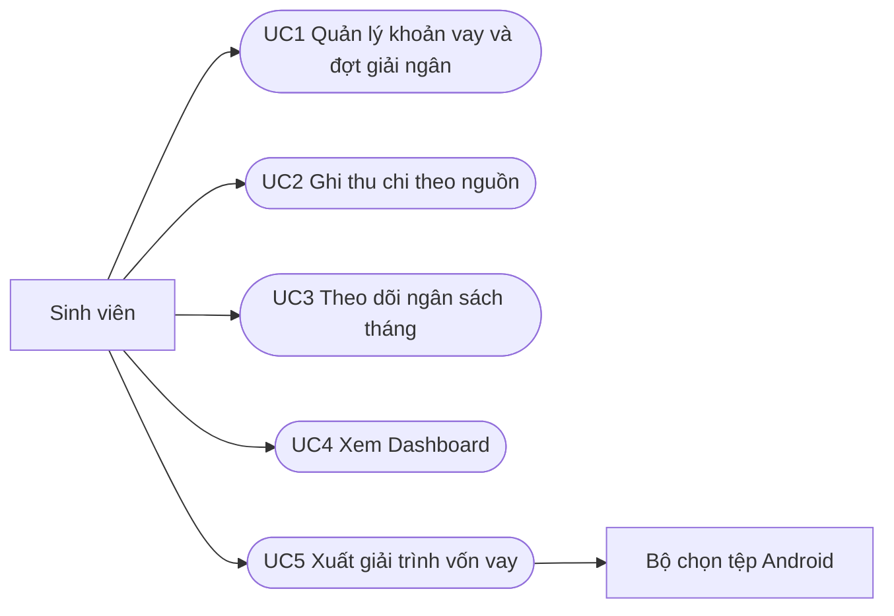

# Use Case

| Use case | Tiền điều kiện và kích hoạt | Luồng chính | Nhánh thay thế hoặc lỗi | Hậu điều kiện |
|---|---|---|---|---|
| UC1 / US1 | Mở mục Khoản vay | 1. Tạo hồ sơ và hạn mức. 2. Chọn hồ sơ, nhập ngày và số tiền đợt. 3. Lưu, xem tổng đã nhận. | Có thể sửa hoặc xóa theo ràng buộc F1. Nếu vượt hạn mức, giữ biểu mẫu và báo phần còn có thể nhận. | Đợt hợp lệ xuất hiện trong danh sách nguồn chi. |
| UC2 / US2 | Có danh mục phù hợp. Chi vốn vay cần đợt đã nhận. | 1. Chọn thu/chi. 2. Nhập ngày, danh mục, nguồn, số tiền và ghi chú tùy chọn. 3. Lưu. 4. Xem chi tiết. | Thu chỉ dùng nguồn cá nhân. Sửa/xóa từ chi tiết. Hủy xóa giữ bản ghi. Ngày hoặc vốn không hợp lệ thì báo lỗi. | Sổ và các phép tổng hợp phản ánh cùng trạng thái. |
| UC3 / US3 | Mở Ngân sách, chọn tháng | 1. Chọn danh mục chi. 2. Đặt hạn mức. 3. Xem đã chi và còn lại. | Cặp đã có mở bản hiện tại để sửa. Vượt hạn mức hiển thị số vượt. Chưa có hạn mức hiển thị lời mời tạo. | Lưu một ngân sách cho cặp tháng và danh mục. |
| UC4 / US4 | Mở Dashboard | 1. Mặc định tháng hiện tại. 2. Đọc tổng và phân bổ chi. 3. Đổi tháng để đối chiếu. | Tháng rỗng hiển thị 0, tránh chia cho 0 khi tính tỷ trọng. | Chỉ đọc dữ liệu. |
| UC5 / US5 | Có hồ sơ vay | 1. Chọn khoản vay, từ ngày, đến ngày. 2. Xem trước. 3. Chọn PDF hoặc CSV. 4. Chọn vị trí lưu. | Từ ngày sau đến ngày thì yêu cầu sửa. Hủy bộ chọn quay lại xem trước. Lỗi ghi cho phép chọn nơi lưu lại. | Hoàn tất khi đóng luồng ghi thành công, sổ gốc giữ nguyên. |
